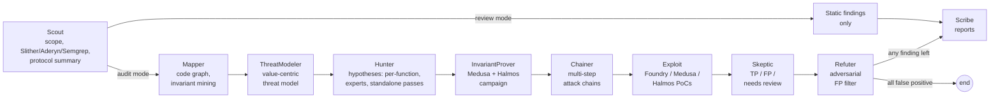

# audit-agent

audit-agent is a research prototype of a multi-agent LLM pipeline that looks for
security vulnerabilities in Solidity smart contracts. Ten specialised agents,
orchestrated with LangGraph, scope the code, build a call/data-flow graph, model
threats, generate vulnerability hypotheses, try to prove them with Foundry,
Medusa and Halmos in Docker, challenge them adversarially and write
platform-style reports. The project's goal is to measure, with a reproducible
and honest methodology, how far such a pipeline gets on real audit contests,
and which stages help.

> **Status:** research code. In a small pilot (two contests, 7 official
> findings) the pipeline matched none of them — see [Evaluation](#evaluation).
> Read [Limitations](#limitations) before relying on any output.

## Pipeline



| Agent | Role |
|---|---|
| Scout | Resolves scope (`scope.txt` or auto-detect), runs static analyzers, summarises the protocol, collects docs |
| Mapper | Builds the contract graph from Slither output, scores attack surface, mines invariants |
| ThreatModeler | Actors, assets, trust boundaries and value-ranked targets that steer Hunter |
| Hunter | Generates hypotheses (forced tool calls) per high-surface function plus expert and standalone passes |
| InvariantProver | Protocol-wide Medusa/Halmos campaign over mined invariants |
| Chainer | Composes hypotheses into multi-step attack chains from real write→read / call edges |
| Exploit | Generates and runs PoCs in Docker, with a compile/diagnose/fix loop |
| Skeptic | Validates each result against the source code |
| Refuter | Assumes each finding is a false positive and tries to prove it; can only downgrade |
| Scribe | Renders Code4rena / Sherlock / Immunefi / generic reports |

Details: [`ARCHITECTURE.md`](ARCHITECTURE.md).

## Quickstart

Requirements: Python 3.12, [uv](https://docs.astral.sh/uv/), Docker.

```bash
git clone <this repository> && cd web3-auditor
uv sync                       # installs the `audit-agent` CLI
cp .env.example .env          # then set LLM_PROVIDER and an API key
make build-all                # builds Slither, Foundry, Aderyn, Semgrep, Medusa, Halmos images
uv run pytest                 # offline: no .env or API key; Postgres tests run only if Docker is up
```

Optional infrastructure (`make dev-up`: Postgres for resumable runs, Neo4j,
Qdrant, Redis, MinIO) is not needed for audits or benchmarks; without it the
pipeline falls back to in-memory storage.

Audit a public contest repository (any Code4rena / Sherlock contest repo with a
`scope.txt`):

```bash
git clone https://github.com/code-423n4/<contest-repo> /tmp/contest
uv run audit-agent audit /tmp/contest --scope /tmp/contest/scope.txt --platform c4 --no-fuzz
# reports: ./audit-reports/<audit_id>/SUMMARY.md and *-finding.md
# full trail of prompts, tool runs and decisions: /tmp/contest/audit_logs/<audit_id>/
```

`AUDIT_AGENT_TOOL_MODE` controls what happens when a Docker tool is unavailable:
`strict` (default, fail), `lenient` (continue, mark the tool as degraded) or
`mock` (skip Docker; for tests).

## Configuration

All settings are environment variables (or `.env`), see
[`src/audit_agent/config.py`](src/audit_agent/config.py) and
[`.env.example`](.env.example).

**LLM provider.** `LLM_PROVIDER=anthropic | openai | openai_compatible`
(`LLM_BASE_URL` for vLLM, Ollama, OpenRouter, …). Models are set per role:
`SCOUT_MODEL`, `MAPPER_MODEL`, `HUNTER_MODEL`, `EXPLOIT_MODEL`, `SKEPTIC_MODEL`
(also used by Refuter), `SCRIBE_MODEL`, `TRIAGE_MODEL` (empty → Scout model).
`LLM_DISABLE_THINKING=true` turns off chain-of-thought for vLLM-served thinking
models.

**Stages** (all `true` by default):

| Flag | Stage |
|---|---|
| `THREAT_MODEL_ENABLED` | ThreatModeler |
| `TRIAGE_ENABLED` | cheap-model suspicion triage of every in-scope function |
| `HUNTER_NAVIGATOR_ENABLED` | Hunter's agentic codebase-navigation pass |
| `HUNTER_EXPERTS_ENABLED` | Hunter's mixture-of-experts passes |
| `HUNTER_STANDALONE_PASSES_ENABLED` | Hunter's temporal / crypto / cross-contract / aggregation / boundary passes |
| `INVARIANT_PROVER_ENABLED` | InvariantProver |
| `CHAINER_ENABLED` | Chainer |
| `REFUTER_ENABLED` | Refuter |
| `ADERYN_ENABLED`, `SEMGREP_ENABLED` | extra static analyzers in Scout |

**Throughput.** `HUNTER_MAX_CONCURRENCY` (in-flight Hunter LLM calls; use 1–2 on
providers with shared throughput), `HUNTER_TOP_FUNCTIONS`,
`HUNTER_MAX_HYPOTHESES`, `HUNTER_SOURCE_BUDGET_CHARS`.

## Evaluation

### Method

**Datasets and splits.** A benchmark dataset (`benchmarks/datasets/*.json`)
lists contests with the contest code location, the official findings (High and
Medium) and `gt_source`, the URL of the official report the ground truth (GT)
was copied from. GT is never written by hand for test contests.

| Split | Meaning |
|---|---|
| `test` | counted in reported metrics |
| `dev` | used while developing the pipeline (Hunter prompts were tuned on the Code4rena Intuition contest); never reported as test metrics |
| `smoke` | plumbing checks only; Damn Vulnerable DeFi and Ethernaut are `contaminated` (public solutions are in model training data) |

`--after-date` keeps only contests that ended after a date (the model's
knowledge cutoff). Drafts created by `benchmarks/tools/import_contest.py` carry
`needs_review: true` and are skipped until a human has checked every finding.

**Matching a prediction to GT.** A hypothesis (or a final finding, through the
hypothesis it came from) matches a GT finding when

```
function_match AND (class_compatible OR title_jaccard >= 0.2)
```

* `function_match` is mandatory: at least one affected function with the same
  name (case-insensitive, leading `_` ignored); contracts are compared only when
  both sides name one.
* `class_compatible`: both classes map to the same canonical class, or to a
  related pair, in [`benchmarks/taxonomy.py`](benchmarks/taxonomy.py) (18
  classes, aliases, SWC IDs).
* `title_jaccard`: word-level Jaccard similarity of the titles.

Assignment is one-to-one: all matching pairs are sorted by score and assigned
greedily, independent of the order of the predictions. The matcher itself is
checked against manual labels: `audit-agent benchmark labels <run>` writes one row
per hypothesis (`labels_<contest>_run<k>.csv`), a human fills in which GT ids it
describes, and `audit-agent benchmark matcher-agreement <run>` compares the two.

**Manual labelling rules** (fixed before labelling started, 2026-10-15). The
labels file does not show the matcher's decision.

* *Match:* the hypothesis names the same root cause as the GT finding — the
  concrete flaw (e.g. "the wallet address is not part of the signed hash") — at
  the same place in the code. The impact may be described differently.
* *No match:* the same function but a different flaw; or a generic claim
  ("signature replay is possible") that does not say what is missing.
* One hypothesis may match several GT findings; several hypotheses may match
  one GT finding (it counts once).
* Validated findings that match no GT finding are labelled `tp_not_in_gt`,
  `fp`, `duplicate` or `unsure`. `unsure` is preferred to guessing and is counted
  as not a true positive.

**Metrics** (per contest run, then mean and min–max over runs):

| Metric | Definition |
|---|---|
| `recall_hypotheses@30` | share of GT matched by the top-30 hypotheses (by priority) before validation |
| `recall_final` | share of GT matched by final findings with status `validated` or `unverified` |
| `recall_validated` | same, `validated` only |
| `validator_loss` | GT matched by hypotheses but lost at Skeptic/Refuter |
| `precision_gt` | share of `validated` findings that match GT — a lower bound, since valid issues outside the official report count as misses |
| `precision_adjusted` | same, counting unmatched findings a human labelled `tp_not_in_gt` (excluding `duplicate`; `unsure` counts as not a true positive); only when all are labelled |
| `recall_by_severity` | recall for High and Medium GT separately |
| `exploit_stats` | PoC outcomes (`exploited / partial / blocked / error / compile_error`), exploited share for GT-matching vs other hypotheses |
| `validator_confusion` | Skeptic verdict and final status × whether the finding matches GT |
| `cost_usd`, `tokens`, `time_s` | measured per run (token counts from API responses; cost from provider price tables, empty when a model has no price) |

The pipeline's own confidence or verdicts are never used as evidence of
correctness.

**Running it.**

```bash
uv run audit-agent benchmark --dataset <name|path.json> --split test --runs 3 \
    --after-date 2026-01-01 --preset full --out results/
uv run audit-agent benchmark rescore results/<run>      # recompute after matcher/GT changes
uv run audit-agent benchmark report results/<run> ...   # writes results/RESULTS.md
```

Each run stores the raw final state, so metrics can be recomputed without
re-running the pipeline. `--preset` (`full`, `no_refuter`, `no_experts`,
`no_threat_model`, `hunter_only`) switches stages off for ablations; the preset
and every `*_ENABLED` flag are recorded with the results.

`--preset baseline` replaces the pipeline with a single LLM agent
(`src/audit_agent/agents/baseline.py`) that has a `bash` tool in the Foundry
image (network disabled, on a copy of the code) and a `file_edit` tool, and
submits findings through the same `report_hypotheses` schema. Its limits are
`BASELINE_MAX_TOKENS`, `BASELINE_MAX_SECONDS` and `BASELINE_MAX_STEPS`; set them
to the per-contest usage measured for `full` to compare at an equal budget.
Like `hunter_only`, its findings are all `unverified`, so compare it on
`recall_hypotheses@30` and `recall_final`.

### Results (pilot, 2026-10-15)

**Summary.** In a 5-run pilot on two Code4rena contests (7 official findings,
one contest contaminated), no hypothesis matched an official finding under
manual labelling. An automatic matcher reported 21 matches; none survived
manual review. All 7 PoCs the pipeline marked `exploited` fail a strict check
(mocks, `assertTrue(true)`, self-comparing asserts). The pipeline often finds
the right function but names the wrong mechanism.

**Setup.** Every role runs on `qwen/qwen3.7-max` through OpenRouter (knowledge
cutoff: not disclosed by the provider; model released 2026-05-21). Two test
contests, `n = 1` run per contest and preset, 5 runs in total. All runs use
budget-reduced Hunter settings: `HUNTER_TOP_FUNCTIONS=8` (default 12),
`HUNTER_SOURCE_BUDGET_CHARS=80000` (default 200000), `HUNTER_NAVIGATOR_LEADS=2`
(default 4), `HUNTER_MAX_CONCURRENCY=3`, with `LLM_REASONING_MAX_TOKENS=2048`
and `LLM_MIN_OUTPUT_TOKENS=32768`. Every
number below comes from `results/<run>/metrics.json`, `results/RESULTS.md`
(`benchmark report`) or `results/ANALYSIS.md` (`benchmark analysis`).

| Contest | GT findings | Status for this model |
|---|---|---|
| Code4rena 2026-04 Monetrix | 1 (0 High, 1 Medium) | test: findings published 2026-05-26, after the model's release; the code was public from the contest (2026-04-24 – 2026-05-04) |
| Code4rena 2025-10 Sequence | 6 (2 High, 4 Medium) | contaminated: official report published 2025-11-21, before the model's release — shown for comparison only |

**Recall by manual labels** (rules above) is the main metric; the matcher's
figure and its agreement with the labels stand next to it. With 1 and 6 GT
findings the counts matter more than percentages, so counts are given.

| Run (`results/…`) | Contest (GT) | Preset | Hypotheses | Recall hyp@30, manual | Recall final, manual | Recall hyp@30, matcher | Matcher = manual (hypothesis × GT pairs) | Validated findings → manual label | Cost | Time |
|---|---|---|---|---|---|---|---|---|---|---|
| `20261015T065633Z_hunter_only…` | Monetrix (1) | hunter_only | 23 | 0/1 | 0/1 | 0/1 | 23/23 | – | $1.27¹ | 15.5 min |
| `20261015T071246Z_full…` | Monetrix (1) | full, before the harness fix | 20 | 0/1 | 0/1 | 0/1 | 20/20 | 2 → 1 fp, 1 unsure | $5.21 | 94.2 min |
| `20261015T190813Z_full…` | Monetrix (1) | full, after the harness fix | 24 | 0/1 | 0/1 | 0/1 | 24/24 | 1 → unsure | $5.15 | 94.2 min |
| `20261015T063343Z_hunter_only…` | Sequence, contaminated (6) | hunter_only | 25 | 0/6 | 0/6 | 4/6 | 135/150 | – | $1.65¹ | 19.1 min |
| `20261015T174040Z_full…` | Sequence, contaminated (6) | full | 22 | 0/6 | 0/6 | 4/6 | 126/132 | 2 → 1 fp, 1 unsure | $5.37 | 86.9 min |

¹ Recorded tokens × the price used for the other runs ($1.475 / $4.425 per
million input/output tokens). These two runs were priced with an outdated table
($2.50 / $7.50) at run time, so their `metrics.json` shows $2.14 (Monetrix) and
$2.79 (Sequence).

**Matcher agreement.** Over 349 labelled hypothesis × GT pairs the manual
labels contain no match; the matcher reports 21 matches, all on Sequence
(signature-heavy code where almost every hypothesis falls into the
signature-replay class, so the class check stops discriminating). Matcher
precision against the labels is 0/21; its recall is undefined (no positive
labels). Matcher numbers are therefore not reported as results.

#### Analysis

On this sample the useful output is where the pipeline loses bugs and why,
not the percentages (`results/ANALYSIS.md`).

1. **Every GT finding is lost before validation.** In all 5 runs no hypothesis
   matches a GT finding under the labelling rules (Monetrix 0/1 in each of 3
   runs, Sequence 0/6 in both runs). Skeptic and Refuter never saw a GT bug, so
   "validator loss = 0" says nothing about them. Near misses (manual list, not
   counted in recall): for Monetrix M-01, 6 hypotheses in 2 of 3 runs name the
   handling of the 0x811 supplied balance in `_readL1Backing` as the flaw, but a
   different mechanism (mostly double counting) instead of the omitted borrow
   liability; for Sequence H-01, 3 hypotheses in the `hunter_only` run point at
   `recover`/`recoverChained` and the checkpointer, but name a substituted
   checkpointer address or checkpoint value instead of the checkpointer being
   disabled by flag 0x40. One of them (`663c5928`) inverts the `UnusedSnapshot`
   revert condition — a plausible but wrong argument.
2. **What the validators cut.** Refuter reviewed 9, 11 and 11 findings in the
   three full runs and turned 7, 9 and 9 of them into false positives; none of
   them matched GT. What is left after Refuter: 2 validated (1 fp, 1 unsure);
   2 validated (1 fp, 1 unsure); 1 validated (unsure) plus 1 unverified. Of the
   5 validated findings none matches GT, 2 are labelled fp and 3 unsure; none is
   labelled `tp_not_in_gt`.
3. **Why PoCs do not compile** (automatic classification of the last solc
   error, with a seeded sample for manual checking). Monetrix before the
   harness fix: 14/20 PoCs failed to compile — 7 inherited a helper contract
   without forge `Test`, 2 used state of a project test they did not inherit,
   3 invented or misused an API, 1 duplicate declaration, 1 syntax error. The
   first two causes came from a bug in base-harness selection (fixed, see
   CHANGELOG). After the fix: 6/20 (5 invented/misused API, 1 non-`Test`
   parent). Sequence full: 4/20 (2 invented/misused API, 2 other).
4. **Harness fix, before → after** (Monetrix, one run each, indicative only):
   PoCs that fail to compile 14/20 → 6/20; PoCs inheriting a `Test`-derived
   contract 12/20 → 19/20; `exploited` 1/20 → 3/20, strict `exploited` 0 → 0.
5. **`exploited` is not evidence.** A PoC counts as *strict exploited* only if
   it calls an in-scope contract, has no `assertTrue(true)`, no assertion with
   identical sides, and its `-vvvv` re-run shows a passing assertion after a
   successful in-scope call. 0 of the 7 PoCs marked `exploited` pass: 4/7 call
   no in-scope contract (only mocks or self-built data), 2/7 pass through
   `assertTrue(true)`, 2/7 compare an expression with itself, 6/7 have no
   passing assertion after a successful in-scope call. Skeptic validated all 3
   fake-exploited PoCs on Sequence; Refuter rejected them. On Monetrix, Refuter
   rejected 1 and Skeptic 3; all 7 end as false positives.

## Limitations

* **Hunter was tuned on a dev contest.** Its prompts and heuristics were
  iterated on the Code4rena Intuition contest, which is therefore `dev` and
  excluded from test metrics.
* **LLM output is non-deterministic.** Run several times (`--runs`) and report
  the spread.
* **Small sample.** Two test contests with 7 GT findings, one of them
  contaminated; the clean contest has a single GT finding, so its recall can
  only be 0% or 100%. One run per contest and preset — no spread.
* **Ground truth = official findings only.** Official reports miss valid
  issues: real bugs missing from the report count as false positives unless a
  human labels them `tp_not_in_gt`, so `precision_gt` is a lower bound. In the
  pilot 3 of the 5 validated findings are labelled `unsure` and count as not
  true positives.
* **One annotator.** All manual labels come from one person (the author); there
  is no inter-annotator agreement.
* **Budget-reduced Hunter settings** in the pilot (see *Results*); recall at the
  default settings is not measured.
* **Contamination.** The Sequence report predates the model; the Monetrix code
  was public before the model's release (its findings were not).
* **Validators let false positives through.** On one real-world target, 4 of 7
  findings marked *validated* were false positives. This motivated the Refuter
  agent. (Internal run log; not reproducible from `results/`.) In the pilot no
  GT bug reached the validators, so the Refuter's effect on real bugs is still
  not measured.
* **Exploit status is not evidence.** The strict check (analysis only) rejects
  all 7 pilot PoCs marked `exploited`. forge-std ≥ 1.10 does not trace passing
  assertions, so for such projects the last check can be undetermined.
* **No end-to-end exploit on the fork harness yet.** Fork-harness PoCs compile,
  but `exploited > 0` has not been confirmed in a live run.
* **InvariantProver** fails in crytic-compile on projects with heavy external
  imports (flat workspace).
* **Stubs:** the Qdrant knowledge base (historical cases are always empty),
  fork detection (always "not a fork") and the learning loop are placeholders.

## Responsible use

Use this tool only on code you are allowed to test: your own code, public
audit contests within their rules, or programs whose terms permit automated
analysis. Do not submit its output to a contest or bug-bounty program without
verifying it yourself.

Generated exploits run only in simulation: inside Docker, as `forge test`,
Medusa or Halmos against a local EVM or a read-only fork. The pipeline never
broadcasts transactions; generated code that uses `vm.rpc`, `vm.ffi`,
broadcasting cheatcodes or reads private keys from the environment is rejected
before execution (`src/audit_agent/tools/poc_guard.py`), and Foundry runs with
`FOUNDRY_FFI=false`.

## License

MIT — see [LICENSE](LICENSE).
